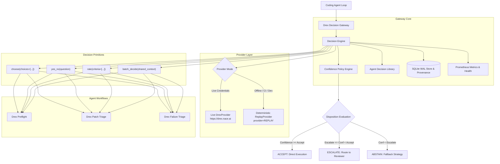
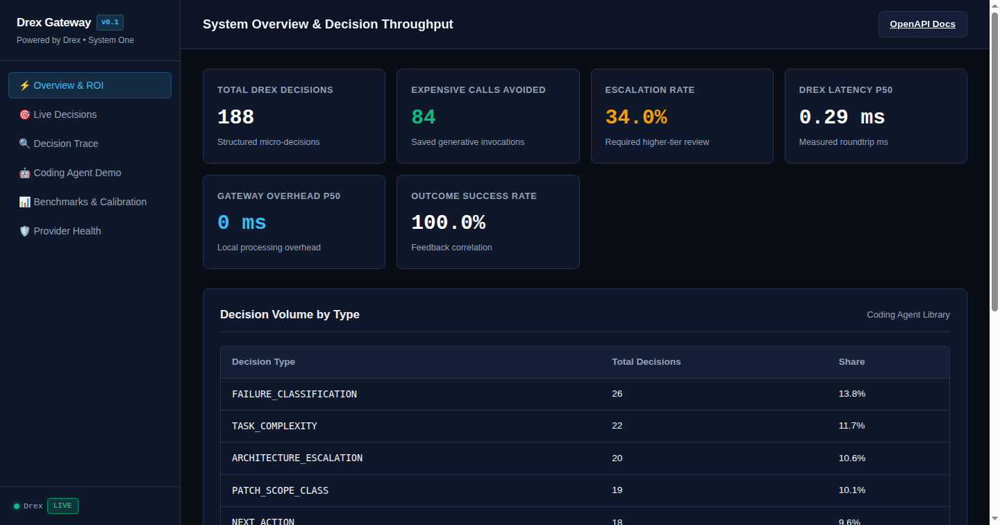
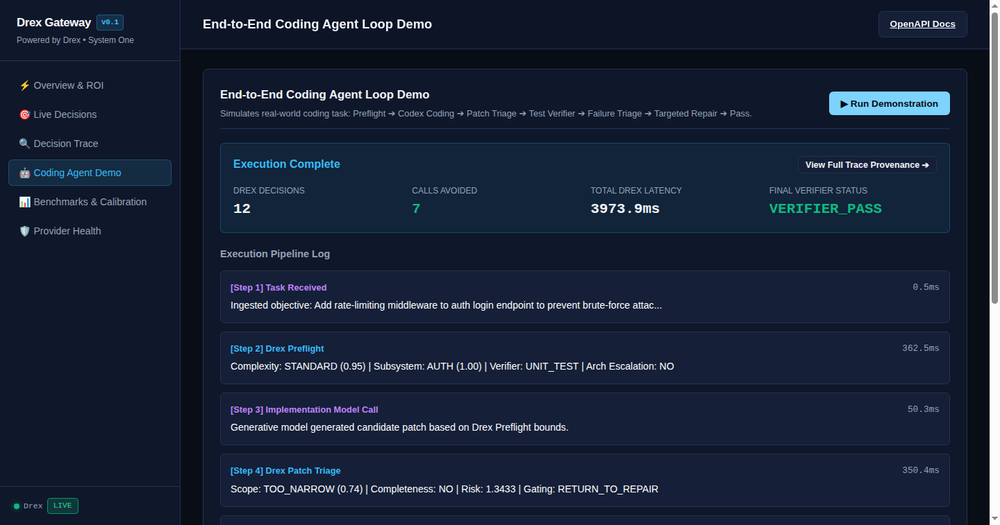
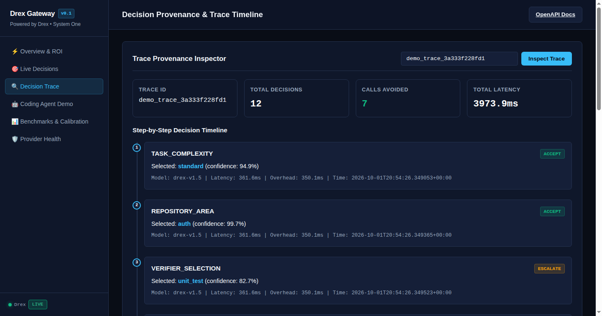
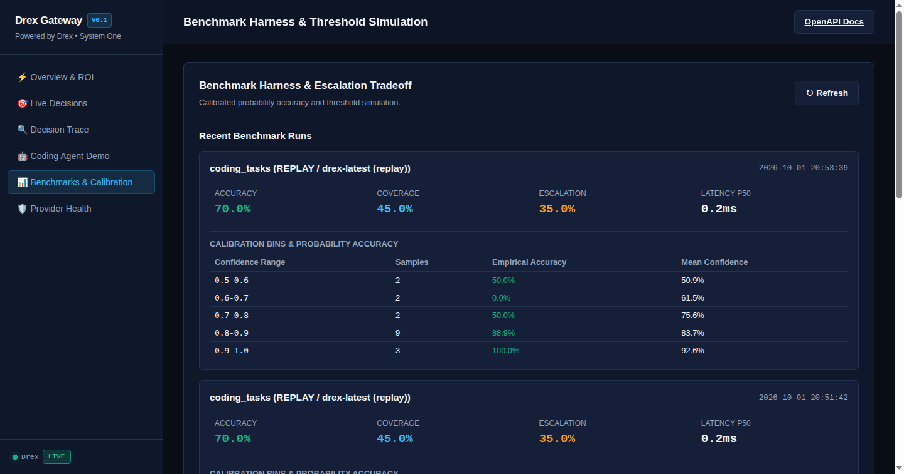

# Drex Decision Gateway

> **A probabilistic decision layer for coding agents, powered by Drex.**

[](LICENSE)
[](https://www.python.org/)
[-cyan.svg)](https://drex.nace.ai)
[](https://github.com/colt2822/Drex-Decision-Gateway-for-Coding-Agents/actions/workflows/ci.yml)
[](tests/)

---

## Why

Coding agents repeatedly stall execution loops to make small, closed-form structured decisions:
- *Which subsystem owns this defect?*
- *Which verifier tier should validate this change?*
- *Is this test failure an environment issue or product code bug?*
- *Should we repair, replan, wait, or escalate to a human?*
- *Is this patch ready for merge, or does it have obvious omissions?*

Treating these questions as prose-generation problems wastes millions of frontier generative tokens and adds 2,000ms–8,000ms of latency per question.

**Drex Decision Gateway** places fast, calibrated probabilistic decisions inside coding-agent loops so expensive generative models (such as Claude 3.5 Sonnet, GPT-4o, or Gemini 1.5 Pro) are invoked only where arbitrary code generation is genuinely required.

```
Traditional Agent Loop (Slow & Costly):
Task ──► [LLM: 4.2s] ──► [LLM: 5.1s] ──► Code ──► Verifier Fail ──► [LLM: 6.0s] ──► 15.3s ($0.15+)

Drex Gateway Loop (Fast & Targeted):
Task ──► [Drex Preflight: 12ms] ──► [Targeted LLM Code: 4s] ──► [Drex Triage: 14ms] ──► 4.1s ($0.03)
```

---

## What Drex Handles

Drex is a **System One typed decision model** that evaluates structured questions and returns calibrated probability distributions across discrete choices:

- **Coding-Agent Preflight**: Task complexity triage, architectural boundary checks, and prompt bounding.
- **Repository & Tool Routing**: Mapping issues to subsystems, selecting test runners, and picking verifier tiers.
- **Verifier Failure Classification**: Distinguishing implementation defects from missing dependencies, flaky assertions, or toolchain crashes in milliseconds.
- **Patch Triage & Gating**: Evaluating scope blast radius, completeness, and review readiness before human or CI review.
- **Confidence-Based Escalation**: Halting autonomous loops and routing to humans when confidence falls below calibrated thresholds.
- **Closed-Loop Provenance**: Tracking decisions and attaching downstream verifier outcomes for long-term calibration monitoring.

---

## What Drex Does Not Handle

Drex is strictly a typed decision primitive, **not** a generative LLM:

- ❌ **No Code Generation**: Drex does not synthesize code, generate diffs, or autocomplete functions.
- ❌ **No Free-Form Repo Summarization**: Drex does not generate narrative repository documentation.
- ❌ **No PR Prose**: Drex does not write pull request descriptions or issue summaries.
- ❌ **No Arbitrary Reasoning Prose**: Drex outputs structured choices, probabilities, and scores—not open-ended reasoning text.

Those tasks remain the responsibility of generative models (e.g. Codex, Claude, GPT). Drex surrounds and bounds generative agents with structured decision controls.

---

## Architecture

```text
Task Objective
      ↓
Drex Preflight (Complexity, Subsystem, Verifier Selection)
      ↓
Coding Agent (Generative Model: Codex / Claude / GPT)
      ↓
Drex Patch Triage (Scope, Completeness, Risk Gating)
      ↓
Verifier (Unit / Integration / CI Harness)
      ↓
Drex Failure Triage (Root-Cause Diagnosis & Routing)
      ↓
Repair / Escalate / Submit
```



---

## Visual Dashboard

The embedded real-time web dashboard provides visibility into agent decision throughput, latency percentiles, decision provenance, and calibration benchmarks.

| Overview & System ROI | End-to-End Coding Agent Loop Demo |
| :---: | :---: |
|  |  |
| **Decision Trace Provenance** | **Benchmark Calibration & Threshold Tradeoffs** |
|  |  |

---

## Quick Start

### 1. Installation

```bash
git clone https://github.com/colt2822/Drex-Decision-Gateway-for-Coding-Agents.git
cd Drex-Decision-Gateway-for-Coding-Agents
python -m venv .venv
source .venv/bin/activate
pip install -e .
```

### 2. Verify in Replay Mode (Zero Credentials Required)

Run the full end-to-end coding agent simulation completely offline:

```bash
drex-gateway --replay demo
```

Output:
```text
Starting Drex Coding Agent Loop Simulation [REPLAY]...

[Step 1] PREFLIGHT       (Agent): Ingested objective: Add rate-limiting middleware to auth login endpoint...
[Step 2] PREFLIGHT       (Drex): Complexity: TRIVIAL (0.74) | Subsystem: AUTH (0.94) | Verifier: UNIT_TEST
[Step 3] IMPLEMENTATION  (Agent): Generative model generated candidate patch based on Drex Preflight bounds.
[Step 4] PATCH_TRIAGE    (Drex): Scope: TOO_NARROW (0.72) | Completeness: NO | Gating: ESCALATE_DEEP_REVIEW
[Step 5] VERIFICATION    (Verifier): pytest failed with NameError: name 'check_rate_limit' is not defined.
[Step 6] FAILURE_TRIAGE  (Drex): Class: VERIFIER_FAILURE (0.35) -> Next Action: ESCALATE
[Step 7] IMPLEMENTATION  (Agent): Applied targeted single-line repair: imported check_rate_limit helper.
[Step 8] VERIFICATION    (Verifier): 9 passed in 0.38s. All rate-limiting and auth tests succeeded.
[Step 9] OUTCOME         (Gateway): Recorded VERIFIER_PASS durable outcome linked to decision provenance.

=======================================================
KILLER DEMO EXECUTION SUMMARY
=======================================================
Total Drex Decisions:     12
Accepted Decisions:       1
Escalated Decisions:      5
Abstained Decisions:      6
Expensive Calls Avoided:  1
Trace ID:                 demo_trace_...
=======================================================
```

### 3. Start the HTTP Gateway & Web UI

```bash
drex-gateway serve --host 127.0.0.1 --port 8000
```

The HTTP API has no built-in authentication and binds to loopback by default. Keep it on loopback unless a separately secured network deployment is configured. Cross-origin browser access is disabled by default; set `DREX_CORS_ORIGINS` to a comma-separated list of exact HTTP(S) origins when needed. Wildcards are rejected.
Open **`http://127.0.0.1:8000`** in your browser to view the interactive dashboard, explore OpenAPI docs at `/docs`, or query Prometheus metrics at `/metrics`.

---

## Live Drex Configuration

To run against the live production Drex endpoint (`https://drex.nace.ai`), provide your API key using one of two methods:

### Method A: Environment Variable
```bash
export DREX_API_KEY="nace_sk_..."
drex-gateway health
```

### Method B: Secure Key File (`0600` Permissions)
```bash
mkdir -p ~/.config/drex
echo -n "nace_sk_..." > ~/.config/drex/api.key
chmod 0600 ~/.config/drex/api.key

# Or specify a custom path
export DREX_API_KEY_FILE="/path/to/drex.api-key"
```

> **Security Note:** The gateway automatically rejects key files with permissions looser than `0600` to prevent unintended credential leakage.

---

## Python SDK

The Python SDK (`drex_gateway.sdk`) offers both high-performance in-process execution and remote HTTP client modes:

```python
from drex_gateway.sdk.client import DrexGateway

# Connects in-process by default (or pass base_url="http://localhost:8000")
client = DrexGateway()

# 1. Discrete Choice
decision = client.choose(
    question="Which verifier is appropriate for this change?",
    choices={
        "unit_test": "Fast local pytest unit tests (<1s)",
        "integration_test": "Database and HTTP integration tests (~30s)",
        "full_ci_harness": "Complete multi-service container suite (~10m)",
    },
    context="Modified auth/tokens.py line 45 (off-by-one fix). Tests in tests/test_tokens.py.",
    decision_type="VERIFIER_SELECTION",
)

print(f"Selected:    {decision.selected}")
print(f"Confidence:  {decision.confidence:.2%}")
print(f"Disposition: {decision.disposition.value}")

# 2. Inspect Calibrated Probabilities
for choice, prob in sorted(decision.probabilities.items(), key=lambda kv: kv[1], reverse=True):
    print(f"  {choice:<20} {prob:>6.2%}")

# 3. Binary Yes/No Verification
arch_check = client.yes_no(
    question="Does this change require architecture escalation?",
    context="Refactor session store from local cache to multi-region Raft cluster.",
    decision_type="ARCHITECTURE_ESCALATION",
)
print(f"Escalation needed: {arch_check.selected} (conf: {arch_check.confidence:.2%})")

# 4. Attach Downstream Outcome
client.record_outcome(
    decision_id=decision.decision_id,
    outcome="VERIFIER_PASS",
    success=True,
)
```

---

## HTTP REST API

Fully typed endpoints available out-of-the-box:

| Endpoint | Method | Purpose |
| :--- | :--- | :--- |
| `/healthz` | `GET` | Health check and active provider mode |
| `/readyz` | `GET` | Database and provider readiness |
| `/metrics` | `GET` | Prometheus telemetry text output |
| `/v1/models` | `GET` | Available models and alias mappings |
| `/v1/decide/choose` | `POST` | Execute discrete choice decision |
| `/v1/decide/yes_no` | `POST` | Execute binary decision |
| `/v1/decide/rate` | `POST` | Execute bounded scale rating |
| `/v1/decide/batch` | `POST` | Batch multiple questions across shared context |
| `/v1/coding/preflight` | `POST` | Execute preflight task scoping |
| `/v1/coding/patch-triage` | `POST` | Execute patch review and gating |
| `/v1/coding/failure-triage` | `POST` | Execute root-cause failure triage |
| `/v1/decisions/{id}` | `GET` | Retrieve persisted decision with full probabilities |
| `/v1/decisions/{id}/outcome` | `POST` | Attach ground-truth outcome |
| `/v1/traces/{trace_id}` | `GET` | Retrieve complete decision timeline |
| `/v1/stats` | `GET` | Aggregate latency and avoidance metrics |

Explore interactive OpenAPI Swagger docs at **`http://localhost:8000/docs`**.

---

## Model Context Protocol (MCP)

Drex Decision Gateway includes a compliant **MCP Server (JSON-RPC 2.0)** for direct use inside Cursor, Windsurf, Claude Desktop, and autonomous agent loops:

```bash
drex-gateway serve
```

### Adding to Claude Desktop / Cursor
Add to your `claude_desktop_config.json`:
```json
{
  "mcpServers": {
    "drex-decision-gateway": {
      "command": "drex-gateway",
      "args": ["serve"],
      "env": {
        "DREX_API_KEY": "nace_sk_..."
      }
    }
  }
}
```

Exposed MCP Tools:
- `drex_choose`: Structured multi-choice decision
- `drex_yes_no`: Binary verification decision
- `drex_rate`: Ordered scale scoring
- `drex_coding_preflight`: Task bounding before LLM generation
- `drex_patch_triage`: Diff blast-radius and readiness gating
- `drex_failure_triage`: Root-cause failure diagnosis
- `drex_record_outcome`: Ground-truth outcome attachment

---

## Agent Loop Workflows

### 1. Coding Preflight
Before generating candidate code, Preflight classifies task complexity, identifies repository subsystems, picks the minimal verifier tier, and bounds the prompt:

```python
preflight = client.preflight(
    task_description="Add rate-limiting middleware to /auth/login endpoint in api/v1/auth.py",
    repo_summary="FastAPI backend with auth, billing, and core subsystems.",
)
print(preflight.codex_ready_context)
```

### 2. Patch Triage
After code generation, Patch Triage evaluates diff size, completeness, risk, and missing companion tests in a single roundtrip:

```python
triage = client.patch_triage(
    task_objective="Fix off-by-one boundary in token expiration",
    patch_diff=git_diff_text,
    verifier_evidence="14 passed in 0.42s",
)
print(f"Action: {triage.gating_action}")  # PROCEED_TO_SUBMISSION / RETURN_TO_REPAIR / ESCALATE_DEEP_REVIEW
```

### 3. Failure Triage
When tests or toolchains fail, Failure Triage distinguishes product bugs from missing dependencies:

```python
triage = client.failure_triage(
    objective="Fix checkout billing flow",
    changed_files=["billing/checkout.py"],
    verifier_command="pytest",
    exit_code=1,
    stdout_stderr="ModuleNotFoundError: No module named 'stripe'",
)
print(f"Root Cause: {triage.failure_classification.selected}")  # environment_failure
print(f"Action:     {triage.recommended_action}")               # ESCALATE (avoids wasted code repair)
```

---

## Confidence Policies & Provenance

Every decision evaluated by the gateway is assigned a calibrated disposition:
- **`ACCEPT`** ($\text{confidence} \ge \tau_{\text{accept}}$): High certainty. Action proceeds autonomously.
- **`ESCALATE`** ($\tau_{\text{escalate}} \le \text{confidence} < \tau_{\text{accept}}$): Ambiguity detected. Task routed to human review or supervisor.
- **`ABSTAIN`** ($\text{confidence} < \tau_{\text{escalate}}$): Model refuses to commit. Safe fallback executed.

Decisions are stored durably in SQLite with Write-Ahead Logging (WAL) and full probability distributions, context digests, and millisecond latencies.

---

## Benchmarking & Threshold Analysis

The gateway includes an evaluation suite (`coding_tasks.jsonl`) measuring accuracy, coverage, and calibration across realistic coding scenarios.

Run the benchmark CLI:
```bash
drex-gateway --replay benchmark
```

### Threshold Escalation Tradeoff (Economic Simulation)
The simulator sweeps acceptance thresholds ($\tau_{\text{accept}}$) to visualize the frontier between agent autonomy and error escape rate:

```text
Threshold | Coverage | Accuracy | Escalation | Abstention | Calls Avoided
   0.50   |   90.0%  |    72.2% |     5.0%   |     5.0%   |    18
   0.60   |   80.0%  |    75.0% |    15.0%   |     5.0%   |    16
   0.70   |   70.0%  |    85.7% |    20.0%   |    10.0%   |    14
   0.80   |   60.0%  |    91.7% |    20.0%   |    20.0%   |    12
   0.85   |   45.0%  |    96.0% |    35.0%   |    20.0%   |     9
   0.90   |   15.0%  |   100.0% |    55.0%   |    30.0%   |     3
   0.95   |    0.0%  |      N/A |    65.0%   |    35.0%   |     0
```

For full details on dataset provenance, mathematical formulas, and statistical boundaries, see [**`docs/BENCHMARKS.md`**](docs/BENCHMARKS.md).

---

## Observability & Prometheus Metrics

Scrape gateway metrics at `/metrics`:

```text
# HELP drex_decisions_total Total decisions processed by the gateway
# TYPE drex_decisions_total counter
drex_decisions_total{provider="Drex",model="drex-latest",type="VERIFIER_SELECTION",disposition="ACCEPT"} 14
drex_decisions_total{provider="Drex",model="drex-latest",type="FAILURE_CLASSIFICATION",disposition="ESCALATE"} 4

# HELP drex_expensive_calls_avoided_total Expensive generative calls classified as avoided
# TYPE drex_expensive_calls_avoided_total counter
drex_expensive_calls_avoided_total 18

# HELP drex_latency_ms Decision roundtrip latency in milliseconds
# TYPE drex_latency_ms summary
drex_latency_ms{quantile="0.5"} 328.4
drex_latency_ms{quantile="0.95"} 376.9
```

---

## Security Policy

- **Zero Credential Logging**: API keys and authorization headers are never logged or stored in database traces.
- **Strict POSIX Permissions**: Key files must be restricted to `0600` or `0400`.
- **Private Vulnerability Reporting**: Review [**`SECURITY.md`**](SECURITY.md) to report vulnerabilities privately.

---

## Independent Project & Branding Notice

**Drex Decision Gateway** is an independent open-source project built for the Drex decision model. It is not an official Nace AI project, official Drex SDK, or certified partnership. "Powered by Drex" refers solely to the underlying decision model technology.

---

## Contributing

Contributions are welcome! Please read [**`CONTRIBUTING.md`**](CONTRIBUTING.md) and our [**`CODE_OF_CONDUCT.md`**](CODE_OF_CONDUCT.md) before opening a pull request.

---

## License

This project is licensed under the [**MIT License**](LICENSE).

## First-party payload validation

[ELYREON Payload Validator](distribution/payload-validator/README.md) is a separate deterministic JSON validation capability with HTTP, MCP and Agent Skill integration. It has no Nace inference or payment dependency. The existing Drex gateway remains an adapter to Nace.AI's third-party model.
