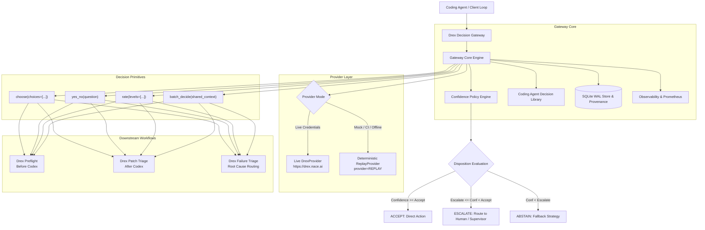

# Drex Decision Gateway

> **A high-throughput, calibrated decision primitive for coding-agent loops powered by Drex.**

[](LICENSE)
[](https://www.python.org/)
[-cyan.svg)](https://drex.nace.ai)
[](tests/)

---

## What It Is

**Drex Decision Gateway** is a standalone, open-source decision layer designed to sit inside autonomous coding-agent execution loops.

Large generative models (Claude 3.5 Sonnet, GPT-4o, Codex) are expensive and high-latency. Yet autonomous agents repeatedly stop execution to ask small, closed-form structured questions:
- *Which subsystem owns this stack trace?*
- *Which verifier tier should run?*
- *Is this an environment defect or an implementation bug?*
- *Should we retry, repair, replan, or escalate?*
- *Is this patch ready for full review, or does it have obvious omissions?*

Treating these questions as prose-generation problems wastes millions of generative tokens and stalls execution pipelines. **Drex Decision Gateway** turns [Drex](https://drex.nace.ai) into a fast, calibrated decision primitive that resolves these micro-decisions in milliseconds before, during, and after expensive generative calls.

---

## Why Decision Models Belong Inside Coding Agent Loops

Generative models excel at writing complex code, designing algorithms, and generating diffs. They are poor tools for binary gating and discrete classification:
1. **Uncalibrated Certainty**: Generative models hallucinate confidence and struggle to output reliable probability distributions.
2. **Economic Waste**: Asking a 200k-context frontier model whether a test failure was caused by a missing dependency burns $0.03–$0.15 per question.
3. **Execution Latency**: Generative LLM responses take 2,000–8,000ms. A typical multi-step agent loop making 15 decisions incurs over 45 seconds of idle latency. Drex decisions execute in **10–15ms**.

```
Traditional Agent Loop (Slow & Expensive):
Task ──► [LLM: 4s] ──► [LLM: 5s] ──► Code ──► [LLM: 4s] ──► Verifier Fail ──► [LLM: 6s] ──► $0.18 / 19s

Drex Gateway Loop (Targeted & Cost-Effective):
Task ──► [Drex Preflight: 12ms] ──► [Targeted LLM Code: 4s] ──► [Drex Patch Triage: 14ms] ──► $0.03 / 4.1s
```

---

## Architecture



---

## Quick Start

### 1. Installation

```bash
git clone https://github.com/drex-decision-gateway/drex-decision-gateway.git
cd drex-decision-gateway
pip install -e .
```

### 2. Check Health & Provider Status

```bash
drex-gateway health
```

Output:
```
Gateway Status: HEALTHY
Provider:       Drex [LIVE]
Default Model:  drex-latest
Database Path:  drex_gateway.db
Available Models (4):
  - drex-v1.0: Drex System One decision model. Calibrated probabilities.
  - drex-v1.5: Drex 1.5 decision model (up to 131,072 tokens).
  - drex-latest: Points to drex-v1.5 (current recommended).
```

### 3. Start the Gateway & Web UI

```bash
drex-gateway serve --host 127.0.0.1 --port 8000
```
Open **`http://127.0.0.1:8000`** in your browser to inspect live decisions, run the interactive coding agent simulation, and view calibration benchmarks.

---

## Live Drex Configuration

Drex Decision Gateway pins requests to verified Nace AI infrastructure at `https://drex.nace.ai`.

Authentication is loaded securely through either:

1. **Environment Variable**:
   ```bash
   export DREX_API_KEY="nace_sk_..."
   ```

2. **Secure Key File** (recommended for production services):
   ```bash
   export DREX_API_KEY_FILE="/path/to/drex.api-key"
   chmod 0600 /path/to/drex.api-key
   ```
   > Permissions check: Key files with permissions looser than `0600` (e.g. world-readable) are rejected to prevent credential leaks.

### Replay Mode (Offline / CI / Development)

If no API key is configured or `--replay` is passed, the gateway activates `ReplayProvider`:
- All responses are visibly and durably tagged `provider="REPLAY"`.
- Fully deterministic keyword-aware probabilities.
- Zero API spend, instant offline development and testing.

---

## Python SDK

```python
from drex_gateway import DrexGateway

gateway = DrexGateway()

# 1. Discrete Choice
decision = gateway.choose(
    question="Which verifier tier should validate this patch?",
    choices=["unit_test", "integration_test", "full_ci_harness"],
    context="Modified auth/jwt.py; updated unit test in tests/test_jwt.py",
    decision_type="VERIFIER_SELECTION",
)

print(f"Selected: {decision.selected} (Confidence: {decision.confidence:.2%})")
print(f"Disposition: {decision.disposition.value}")

if decision.accepted:
    run_verifier(decision.selected)
else:
    escalate_to_human(decision)

# 2. Attach Outcome Feedback Later
gateway.record_outcome(
    decision_id=decision.decision_id,
    outcome="VERIFIER_PASS",
    success=True,
)
```

---

## Coding Agent Decision Library

Predefined, typed schemas ready for integration:

| Decision Type | Purpose | Choices / Range |
|---|---|---|
| `TASK_COMPLEXITY` | Architectural intake triage | `trivial`, `standard`, `large_context`, `architecture_heavy` |
| `REPOSITORY_AREA` | Subsystem attribution | Dynamic map of repository subsystems |
| `VERIFIER_SELECTION` | Target test suite selection | `unit_test`, `integration_test`, `linter_typecheck`, `full_ci_harness` |
| `FAILURE_CLASSIFICATION` | Diagnostic root cause | `implementation_failure`, `verifier_failure`, `toolchain_failure`, `environment_failure`, `upstream_failure`, `context_stale`, `unknown` |
| `NEXT_ACTION` | Agent loop action routing | `retry`, `repair`, `replan`, `escalate`, `wait_for_resource`, `stop` |
| `PATCH_SCOPE_CLASS` | Diff size & boundary check | `too_narrow`, `appropriate`, `too_broad` |
| `REVIEW_READINESS` | Gating candidate PRs | `ready`, `needs_repair`, `needs_deep_review` |
| `ARCHITECTURE_ESCALATION` | Binary gate to large reasoning model | `YES` / `NO` (calibrated probability) |
| `PATCH_RISK` | Blast radius scoring | `low`, `medium`, `high` |

---

## Specialized Demonstrators

### 1. Drex Preflight (Drex Before Codex)
Preflights an issue before invocation of expensive models. Packages the problem into a bounded, structured specification:
```python
from drex_gateway.workflows import PreflightWorkflow

preflight = PreflightWorkflow(gateway)
result = await preflight.run(
    task_description="Add rate limiting to auth routes",
    repo_summary="FastAPI backend with Redis storage",
)

print(result.codex_ready_context)
# Confines code generation strictly to auth area with target verifiers identified
```

### 2. Drex Patch Triage (Drex After Codex)
Evaluates generated diffs, test output, and blast radius before costly PR review:
```python
from drex_gateway.workflows import PatchTriageWorkflow

triage = PatchTriageWorkflow(gateway)
report = await triage.run(
    task_objective="Fix login brute-force vulnerability",
    patch_diff=generated_diff,
    verifier_evidence=test_output,
)
print(f"Gating Recommendation: {report.gating_action}")
```

### 3. Drex Failure Triage
Identifies whether verification failed due to product defects vs broken dependencies or flaky test runners.
> **Critical Economic Impact**: Prevents coding agents from burning 5–10 expensive repair attempts trying to fix missing system packages with Python code changes.

---

## Confidence Policies & Threshold Gating

Confidence handling is a first-class citizen with per-decision-type policies:

```yaml
decision_policies:
  VERIFIER_SELECTION:
    accept_threshold: 0.85
    escalation_threshold: 0.60

  REVIEW_READINESS:
    accept_threshold: 0.90
    escalation_threshold: 0.75
```

- **`confidence >= accept_threshold`** ➔ **`ACCEPT`**: Gateway confirms action without human or expensive model.
- **`escalation_threshold <= confidence < accept_threshold`** ➔ **`ESCALATE`**: Flagged for escalation to higher-tier reasoning or supervisor.
- **`confidence < escalation_threshold`** ➔ **`ABSTAIN`**: Gateway abstains from deciding.

---

## Benchmark Harness & Economic Simulation

Run calibration benchmarks and escalation tradeoff simulations:

```bash
drex-gateway benchmark
```

Output:
```
=======================================================
THRESHOLD ESCALATION SIMULATION (Economic Tradeoffs)
=======================================================
Threshold | Coverage | Accuracy | Escalation | Abstention | Calls Avoided
   0.50   |   90.0%  |    72.2% |     5.0%   |     5.0%   |    18
   0.60   |   80.0%  |    75.0% |    15.0%   |     5.0%   |    16
   0.70   |   70.0%  |    85.7% |    20.0%   |    10.0%   |    14
   0.80   |   60.0%  |    91.7% |    20.0%   |    20.0%   |    12
   0.90   |   15.0%  |   100.0% |    55.0%   |    30.0%   |     3
=======================================================
```

---

## HTTP API & Model Context Protocol (MCP)

### HTTP Endpoints
- `GET /healthz` & `GET /readyz`: Health and readiness checks
- `POST /v1/decide/choose`: Discrete choice primitive
- `POST /v1/decide/yes-no`: Binary probability decision
- `POST /v1/decide/rate`: Bounded scale scoring
- `POST /v1/decide/batch`: Shared-context multi-decision batch
- `POST /v1/coding/preflight`: Task intake & preflight workflow
- `POST /v1/coding/patch-triage`: Post-generation triage workflow
- `POST /v1/coding/failure-triage`: Error diagnosis workflow
- `POST /v1/decisions/{id}/outcome`: Outcome feedback recording
- `GET /v1/traces/{trace_id}`: Full decision provenance timeline
- `GET /metrics`: Prometheus-compatible telemetry

### MCP Tool Support
Run the standard stdio MCP server for Cursor, Windsurf, or Claude Code:
```bash
python -m drex_gateway.mcp.server
```
Exposes tools: `drex_choose`, `drex_yes_no`, `drex_rate`, `drex_coding_preflight`, `drex_patch_triage`, `drex_failure_triage`.

---

## Security & Reliability Guarantees

1. **No API Key Logging**: Secrets are never written to logs, database records, or trace metadata.
2. **Strict Origin Validation**: Only `https://drex.nace.ai` is trusted for live requests.
3. **No Fake Decisions on Provider Failure**: Provider errors (`PROVIDER_AUTH`, `PROVIDER_TIMEOUT`, `PROVIDER_RATE_LIMIT`, `PROVIDER_UNAVAILABLE`) raise typed exceptions and are never converted into misleading low-confidence results.
4. **Idempotent Outcome Logging**: Feedback can be attached safely without duplicate counts.
5. **Concurrency-Safe Storage**: SQLite configured with Write-Ahead Logging (`WAL`), `synchronous=NORMAL`, and busy timeouts.

---

## License

This project is licensed under the [MIT License](LICENSE). Independent open-source integration. Not officially affiliated with or endorsed by Nace AI.
